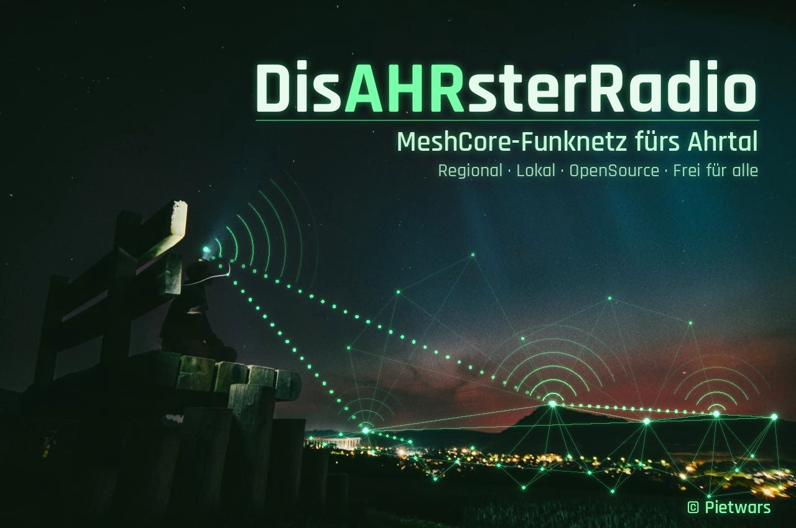
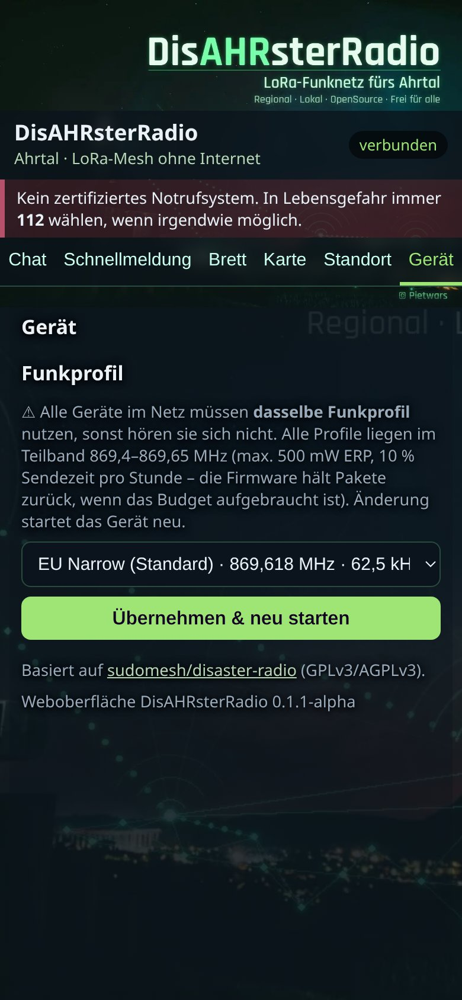
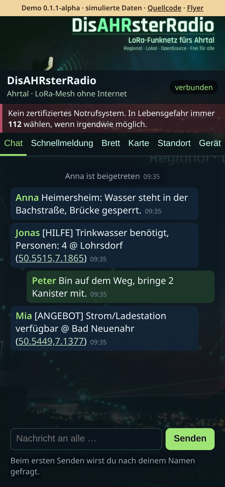
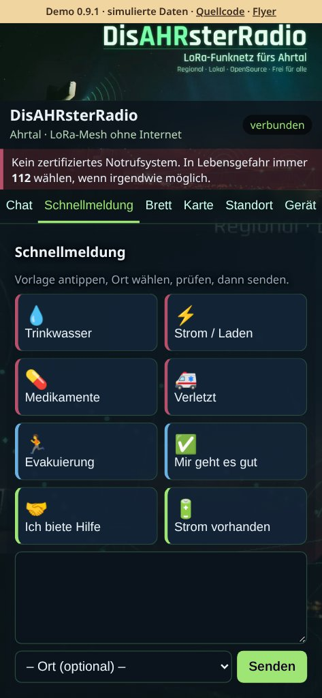
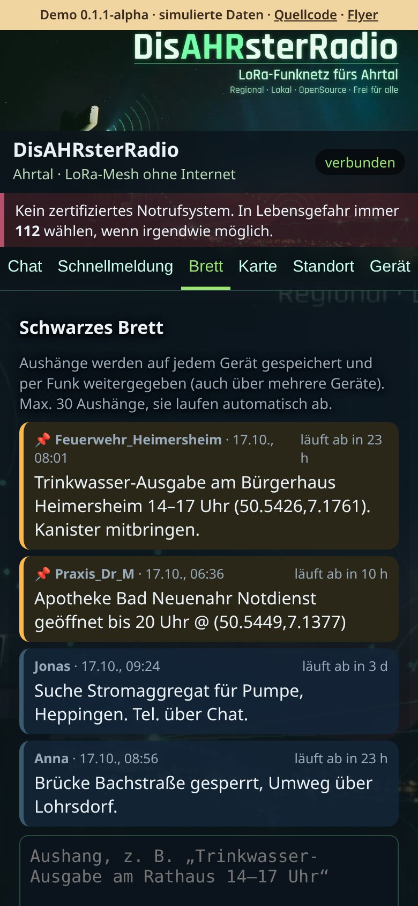
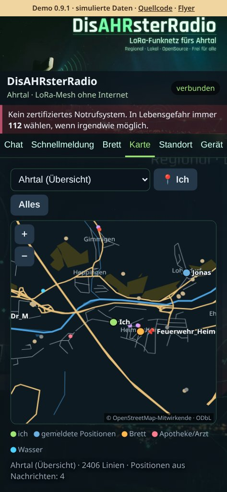
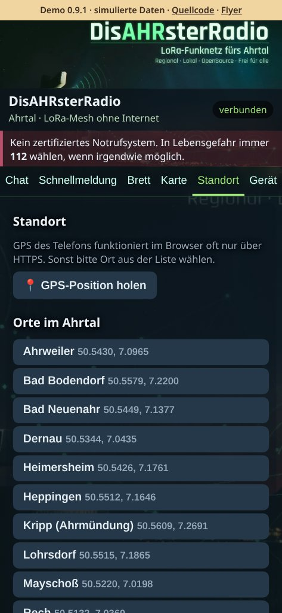
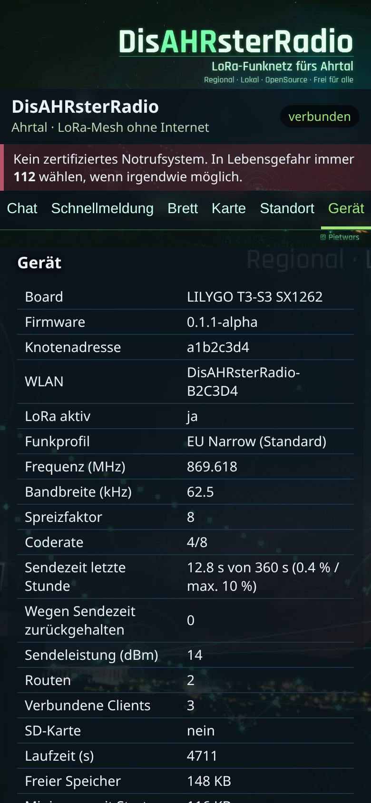
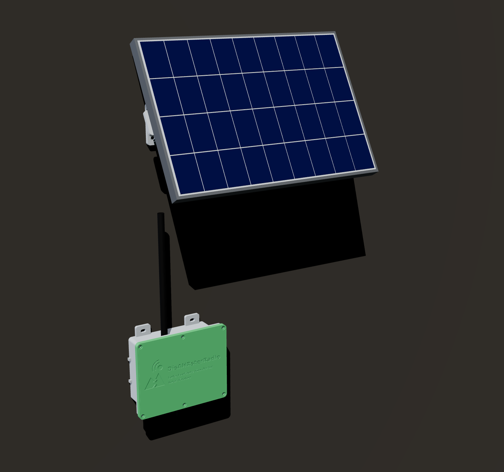

# DisAHRsterRadio

> **Aktueller Stand:** offenes WLAN `DisAHRsterRadio-XXXXXX` → `http://192.168.4.1` bzw. `http://disahrster.local`. In Arbeit: schlankere Firmware, [Omi-Version (PR #14)](https://github.com/Pietwars/DisAHRsterRadio/pull/14) und [Solarbox](hardware/solarbox/) – siehe [In Arbeit](#in-arbeit). [Zugang, Update und Abnahme](docs/OFFENER_ZUGANG.md).


**🔴 Live-Demo (simulierte Daten, kein Gerät nötig): https://pietwars.github.io/DisAHRsterRadio/**



**Version 0.1.1-alpha** (Vorabversion) · disaster-radio/LoRaLayer2 + RadioLib 7 · Weboberfläche MeshAhrtal · 868 MHz · **Download:** [Release v0.1.1-alpha](https://github.com/Pietwars/DisAHRsterRadio/releases/tag/v0.1.1-alpha) (ein Paket pro Board) · **Flyer (A5):** [Druck-PDF mit QR-Codes](docs/flyer/DisAHRsterRadio-Flyer.pdf) · [Digital-PDF mit klickbaren Links](docs/flyer/DisAHRsterRadio-Flyer-digital.pdf)

**Offline-Chat über LoRa-Mesh für das Ahrtal** – ein Gerät spannt ein eigenes WLAN auf, man verbindet sich mit dem Handy und schreibt im Browser. Die Nachrichten laufen per LoRa von Gerät zu Gerät weiter, ganz ohne Internet oder Mobilfunk.

Dieses Projekt ist ein modernisierter Fork von **[sudomesh/disaster-radio](https://github.com/sudomesh/disaster-radio)** mit der Ahrtal-Weboberfläche aus **[Pietwars/DisasterMesh](https://github.com/Pietwars/DisasterMesh)** – aber **ohne MeshCore**: Funk und Routing laufen über das ursprüngliche disaster-radio-Konzept (Layer1 + LoRaLayer2).

<!-- projektfamilie:start (in allen fünf Repositorys identisch; erzeugt mit DisasterMesh/tools/projektfamilie.py) -->
### Projektfamilie DisAHRsterRadio / HaldenFunk

| Repository | Inhalt | Funk | Version | Demo · Download · Flyer |
|---|---|---|---|---|
| [Pietwars/DisasterMesh](https://github.com/Pietwars/DisasterMesh) | Original-Repo: MeshCore 1.18 mit der großen Weboberfläche MeshAhrtal, Karten, Werkzeuge, Doku (Ahrtal) | MeshCore | 0.9.0-alpha | [Live-Demo](https://pietwars.github.io/DisasterMesh/demo/) · Firmware über [Actions](https://github.com/Pietwars/DisasterMesh/actions) · Flyer [Druck](https://pietwars.github.io/DisasterMesh/flyer/DisasterMesh-Flyer.pdf) / [digital](https://pietwars.github.io/DisasterMesh/flyer/DisasterMesh-Flyer-digital.pdf) |
| [Pietwars/DisAHRsterRadio-MeshCore](https://github.com/Pietwars/DisAHRsterRadio-MeshCore) | MeshCore 1.18 mit kompakter MeshAhrtal-Oberfläche per WLAN plus Bluetooth für die MeshCore-App, 105 Geräte (Ahrtal) | MeshCore | 0.9.0-alpha | [Live-Demo](https://pietwars.github.io/DisAHRsterRadio-MeshCore/) · [Release v0.9.0-alpha](https://github.com/Pietwars/DisAHRsterRadio-MeshCore/releases/tag/v0.9.0-alpha) · Flyer [Druck](https://pietwars.github.io/DisAHRsterRadio-MeshCore/flyer/DisAHRsterRadio-MeshCore-Flyer.pdf) / [digital](https://pietwars.github.io/DisAHRsterRadio-MeshCore/flyer/DisAHRsterRadio-MeshCore-Flyer-digital.pdf) |
| [Pietwars/DisAHRsterRadio](https://github.com/Pietwars/DisAHRsterRadio) | Ohne MeshCore: modernisiertes disaster-radio (LoRaLayer2, RadioLib) mit kompakter MeshAhrtal-Oberfläche (Ahrtal) | LoRaLayer2 | 0.1.1-alpha | [Live-Demo](https://pietwars.github.io/DisAHRsterRadio/) · [Release v0.1.1-alpha](https://github.com/Pietwars/DisAHRsterRadio/releases/tag/v0.1.1-alpha) · Flyer [Druck](https://pietwars.github.io/DisAHRsterRadio/flyer/DisAHRsterRadio-Flyer.pdf) / [digital](https://pietwars.github.io/DisAHRsterRadio/flyer/DisAHRsterRadio-Flyer-digital.pdf) |
| [Pietwars/HaldenFunk](https://github.com/Pietwars/HaldenFunk) | Regionalvariante von DisAHRsterRadio für Sangerhausen / Mansfelder Land, ohne MeshCore | LoRaLayer2 | 0.1.1-alpha | [Live-Demo](https://pietwars.github.io/HaldenFunk/) · [Release v0.1.1-alpha](https://github.com/Pietwars/HaldenFunk/releases/tag/v0.1.1-alpha) · Flyer [Druck](https://pietwars.github.io/HaldenFunk/flyer/HaldenFunk-Flyer.pdf) / [digital](https://pietwars.github.io/HaldenFunk/flyer/HaldenFunk-Flyer-digital.pdf) |
| [Pietwars/HaldenFunk-MeshCore](https://github.com/Pietwars/HaldenFunk-MeshCore) | Regionalvariante von DisAHRsterRadio-MeshCore für das Mansfelder Land: MeshCore 1.18, WLAN + Bluetooth, Gerätematrix | MeshCore | 0.1.0-alpha | [Live-Demo](https://pietwars.github.io/HaldenFunk-MeshCore/) · [Release v0.1.0-alpha](https://github.com/Pietwars/HaldenFunk-MeshCore/releases/tag/v0.1.0-alpha) · Flyer [Druck](https://pietwars.github.io/HaldenFunk-MeshCore/flyer/HaldenFunk-MeshCore-Flyer.pdf) / [digital](https://pietwars.github.io/HaldenFunk-MeshCore/flyer/HaldenFunk-MeshCore-Flyer-digital.pdf) |

Gleiche Spalte **Funk** = Geräte können miteinander funken (gleiches Funkprofil vorausgesetzt). MeshCore- und LoRaLayer2-Varianten verstehen sich **nicht**.

**Namen:** **DisAHRsterRadio** = Projekt und Marke (WLAN `DisAHRsterRadio-XXXXXX`) · **MeshAhrtal** = die Weboberfläche im Handy-Browser · **DisasterMesh** = das Original-Repository · **HaldenFunk** = Regionalvariante fürs Mansfelder Land (WLAN `HaldenFunk-XXXXXX`).

Haupt-Boards: LILYGO T3-S3 V1.3, LILYGO T3 V1.6.1 (TTGO), Heltec WiFi LoRa 32 V2 – alle 868 MHz; Hardware-Abnahme steht aus (bisher lief nur LILYGO T3 V1.6.1 mit DisAHRsterRadio beim Nutzer). Druck-Flyer haben QR-Codes, digitale Flyer klickbare Links. Alle Demos sind simuliert.

> ⚠️ Prototyp, kein zertifiziertes Notrufsystem. **Im Notfall immer 112.**
<!-- projektfamilie:end -->

> ⚠️ **Wichtig:** DisAHRsterRadio ist **kein zertifiziertes Notrufsystem** und ersetzt keine Behörden-Kommunikation. In Lebensgefahr immer **112** wählen, wenn irgendwie möglich.

## Ehrlicher Stand (Oktober 2026)

| Punkt | Stand |
|---|---|
| Firmware baut für alle 3 Boards | ✅ (lokal und per GitHub Actions) |
| Auf echter Hardware getestet | ⚠️ teilweise: LILYGO T3 V1.6.1 lief beim Nutzer vollständig (OLED, WLAN, Weboberfläche, Chat, LoRa-Empfang); Heltec V2 zeigte ein Strom-/Brownout-Problem (WLAN-AP fehlte), WLAN-Fix enthalten, ungeprüft; T3-S3 ungetestet |
| Funkverbindung zwischen zwei Geräten | ❓ ungetestet |
| Kompatibel mit altem disaster-radio-Funk (915 MHz/US) | ❌ nein, EU868-Standard |
| Kompatibel mit MeshCore/DisasterMesh-Geräten | ❌ nein, anderes Funkprotokoll |

## Unterstützte Boards

| PlatformIO-Env | Board | Funkchip |
|---|---|---|
| `t3s3-sx1262` | LILYGO T3-S3 (Hauptziel) | SX1262 (TCXO 1,8 V) |
| `t3-v161-sx1276` | LILYGO T3 V1.6.1 | SX1276 |
| `heltec-v2-sx1276` | Heltec WiFi LoRa 32 V2 | SX1276 |

Heltec V2 (WLAN-Fix): Brownout-Detektor früh aus, WLAN startet zuletzt (2 s nach LoRa/Display), WLAN-Sendeleistung 8,5 dBm (Variante `heltec-v2-sx1276-wifi11` mit 11 dBm), softAP auf Kanal 1 mit Prüfung und Neuversuch alle 5 s, LoRa-Sendepause während des WLAN-Starts, Startmarken `[BOOT …]` und alle 30 s WLAN-Name und Adresse seriell und auf dem OLED.

## Was gegenüber disaster-radio modernisiert wurde

- PlatformIO mit **pioarduino** (aktuelles Arduino-ESP32 3.3.x / ESP-IDF 5.5) statt altem Git-Stand der espressif32-Plattform
- **RadioLib 7.x** statt sandeepmistry/arduino-LoRa bzw. uraltem RadioLib-Commit; eine gemeinsame `Layer1_RadioLib` für SX1262 und SX1276 (SX1262 jetzt mit BUSY-Pin, TCXO, DIO2-HF-Schalter)
- **LoRaLayer2** (Routing von disaster-radio) liegt angepasst in `firmware/lib/LoRaLayer2` (Sende-/Empfangsleistung und SF zur Laufzeit, Konfigurationsausgabe auch für RadioLib)
- **ESP32Async/ESPAsyncWebServer + AsyncTCP** (gepflegte Forks), **LittleFS** statt SPIFFS, AsyncSDServer entfernt (SD über ESPAsyncWebServer)
- **EU868-Funkprofile:** Standard 869,618 MHz, 62,5 kHz, SF8, CR 4/8, 14 dBm, Sendezeit-Buchführung (10 %/h) – siehe [Funkprofile](#funkprofile-868-mhz-deutschland)
- Offener WLAN-Zugangspunkt **`DisAHRsterRadio-XXXXXX`** (`http://192.168.4.1`, `http://disahrster.local`, max. 4 Handys). ⚠️ Das WLAN ist offen und unverschlüsselt: Jede Person in Reichweite kann mitlesen und senden.
- BLE-UART ohne PIN in den zusätzlichen `*-ble`-Testprofilen; WLAN bleibt parallel aktiv. Andere Partitionierung und noch keine Hardwareabnahme: [Anleitung](docs/OFFENER_ZUGANG.md).

## Funkprofile (868 MHz, Deutschland)

Alle Profile liegen vollständig im SRD-Teilband **869,4–869,65 MHz** (ETSI EN 300 220 / BNetzA-Allgemeinzuteilung): **max. 500 mW ERP, 10 % Sendezeit**. Die Firmware führt Buch über die Sendezeit der letzten Stunde (RadioLib `getTimeOnAir`) und **hält Pakete zurück**, sobald das 10-%-Budget (360 s/h) erreicht ist. Sendeleistung bleibt bei 14 dBm (Standard, nie über Chipgrenze 22 dBm SX1262 / 20 dBm SX1276).

> ⚠️ **Alle Geräte eines Netzes müssen dasselbe Funkprofil nutzen**, sonst hören sie sich nicht. Auswahl im Reiter **Gerät → Funkprofil** (gespeichert im NVS, Neustart) oder seriell `/set preset N`.

| Nr. | Profil | Frequenz | Bandbreite | SF | CR | Sendezeit je 100-Byte-Nachricht | max. Nachrichten/h (10 %) | Reichweite ↔ Tempo |
|---|---|---|---|---|---|---|---|---|
| 0 | **EU Narrow (Standard)** | 869,618 MHz | 62,5 kHz | 8 | 4/8 | ca. 0,94 s | ca. 385 | ausgewogen, störfest (MeshCore-Standard „EU/UK Narrow“) |
| 1 | Nah/Schnell | 869,525 MHz | 250 kHz | 7 | 4/5 | ca. 0,09 s | ca. 4100 | kurze Reichweite, sehr schnell |
| 2 | Mittel (bisheriger Standard) | 869,525 MHz | 125 kHz | 9 | 4/5 | ca. 0,55 s | ca. 650 | mittel; kompatibel zu Geräten mit alter Firmware |
| 3 | Fern | 869,525 MHz | 125 kHz | 12 | 4/8 | ca. 5,9 s | ca. 60 | größte Reichweite, sehr langsam (LDRO automatisch) |
| 4 | LongFast-ähnlich | 869,525 MHz | 250 kHz | 11 | 4/5 | ca. 0,94 s | ca. 380 | wie Meshtastic „LongFast“ EU; trotzdem nicht Meshtastic-kompatibel |



Sendezeiten berechnet mit expliziter Kopfzeile, CRC, 8 Symbolen Präambel. Funkeinstellungen: Syncword unverändert (privat), CRC an, explizite Kopfzeile, Low-Data-Rate-Optimierung automatisch, SX1262 mit „boosted RX gain“, TCXO 1,8 V (T3-S3), Strombegrenzung 140 mA (SX1262) / 120 mA (SX1276). `/api/info` liefert `preset`, `presetName`, `freq`, `bw`, `sf`, `cr`, `airtimeMs`, `airtimeBudgetMs`, `airtimePct`, `txDeferred`; `/api/presets` listet alle Profile, `POST /api/preset` (`preset=N`) speichert und startet neu.

## Weboberfläche (MeshAhrtal)

| Chat | Schnellmeldung | Brett |
|---|---|---|
|  |  |  |
| **Karte** | **Standort** | **Gerät** |
|  |  |  |

(Aufnahmen der [Live-Demo](https://pietwars.github.io/DisAHRsterRadio/) in Handygröße, Stand 0.1.1-alpha; alle Daten simuliert.)

- Chat an alle (disaster-radio-WebSocket `/ws`, Format `<ID 2 Byte>c|<Name> Text`, Zustellbestätigung ✓ = vom Gerät angenommen, *nicht* beim Empfänger)
- Schnellmeldungen (Trinkwasser, Strom, Medikamente, Verletzt, Evakuierung, „Mir geht es gut“, Hilfe-Angebote)
- Standort: GPS des Telefons (funktioniert im Browser oft nur über HTTPS) oder Auswahl aus der Ortsliste Ahrtal (Ahrweiler … Sinzig)
- **Schwarzes Brett:** Aushänge (optional „wichtig/angeheftet“, Laufzeit 6 h – 7 Tage) werden auf jedem Gerät in LittleFS (`/board.txt`) gespeichert, per Funk als eigener Datagramm-Typ `b` verteilt, anhand einer zufälligen 8-stelligen ID entdoppelt und von jedem Gerät einmal weitergesendet (Mehrsprung). Alle ~5 min sendet jedes Gerät einen gespeicherten Aushang erneut, damit später eingeschaltete Geräte nachziehen. Max. 30 Aushänge pro Gerät; `GET /api/board`
- **Offline-Karte:** fünf OSM-Pakete aus DisasterMesh (Ahrtal-Übersicht, Heimersheim mit Gebäuden, Dernau/Ahrweiler, Altenahr, Sinzig), kompakt, vereinfacht und gzip-komprimiert (zusammen ca. 190 KB) im LittleFS; Anzeige mit Orten, Versorgungspunkten, eigener Position und Positionen aus Chat-/Brett-Nachrichten (Koordinaten im Text). Erzeugen mit `tools/make_map.py` und verkleinern mit `tools/shrink_maps.py` (Douglas-Peucker, Mindestlängen/-flächen, gleiches Verfahren wie in HaldenFunk; Prüfung: `tests/maps.test.py`). © OpenStreetMap-Mitwirkende, ODbL 1.0 (`web/static/map/ODbL-1.0.txt`)
- Geräteinfo über `GET /api/info` (JSON)
- Demo ohne Gerät: [Live-Demo](https://pietwars.github.io/DisAHRsterRadio/) oder `web/static/index.html?demo=1` lokal öffnen

Die MeshCore-spezifischen Funktionen aus DisasterMesh (Kanäle, Direktnachrichten, Karten-Download/-Import, eigene POIs, Admin) sind **nicht** übernommen.

## Erste Schritte

```bash
pip install platformio==6.2.0
cd firmware
pio run -e t3s3-sx1262 -t upload      # Firmware
pio run -e t3s3-sx1262 -t uploadfs    # Weboberfläche (LittleFS)
pio device monitor                     # zeigt WLAN-Name und Adresse
```

Dann mit dem WLAN `DisAHRsterRadio-XXXXXX` verbinden und `http://192.168.4.1` (oder `http://disahrster.local`) öffnen. Höchstens 4 Handys gleichzeitig. Betreiberkonsole nur über USB (Telnet entfernt).

> ⚠️ Offenes, unverschlüsseltes WLAN: Jede Person in Reichweite kann mitlesen und senden.

## Fertige Flash-Pakete

Fertige Pakete gibt es unter [Releases](https://github.com/Pietwars/DisAHRsterRadio/releases): je Board `DisAHRsterRadio-<Version>-<Board>.zip` mit `…-factory.bin` (komplett an 0x0, z. B. mit https://espressif.github.io/esptool-js/), Einzelteilen unter `teile/`, `SHA256SUMS` und deutscher `ANLEITUNG.md`. Update ohne Datenverlust: nur `teile/firmware.bin` an 0x10000.

Releases entstehen automatisch: Ein Tag `v<Version>` (passend zur Datei `VERSION`) startet den Workflow `release.yml`, der alle drei Boards baut, mit `tools/package.sh` packt, mit `tools/verify_release.py` prüft (bricht ab, wenn eine Datei fehlt, leer ist oder eine Prüfsumme nicht stimmt) und als Vorabversion veröffentlicht. Plattform und Bibliotheken sind fest gepinnt (`firmware/platformio.ini`), PlatformIO in der CI auf 6.2.0.

## Gemeinsamer Kern mit HaldenFunk

DisAHRsterRadio ist der **gemeinsame Kern**; [HaldenFunk](https://github.com/Pietwars/HaldenFunk) ist die Regionalvariante fürs Mansfelder Land. HaldenFunk enthält keine eigene Kopie, die von Hand gepflegt wird: Alle Kern-Dateien (Firmware, Weboberfläche, Werkzeuge, Tests, Workflows) entstehen dort aus diesem Repository in einer festen Revision (`region/CORE`) plus einem kleinen Regional-Overlay (`region/overlay.patch`: Name, WLAN/mDNS, Begrüßung, Farben, Orte, Kartenliste, Demo-Inhalte, Paketpräfix). Rein regionale Dateien (README, Karten, Bilder, Doku, Flyer) stehen in `region/own.txt`. Die CI von HaldenFunk prüft mit `tools/core_sync.py --check`, dass nichts auseinanderläuft.

**Ablauf:** Fehlerbehebungen und neue Funktionen hier umsetzen → in HaldenFunk `python3 tools/core_sync.py --update` (übernimmt den neuen Kern, wendet das Overlay an) → bauen, testen, committen. Details: [HaldenFunk/docs/KERN_UND_REGION.md](https://github.com/Pietwars/HaldenFunk/blob/main/docs/KERN_UND_REGION.md).

## In Arbeit

Noch nicht in `main` bzw. noch nicht getestet:

- **Omi-Version** – Entwurf [PR #14](https://github.com/Pietwars/DisAHRsterRadio/pull/14): nur Ein/Aus, fester Displaytext, WLAN `Notfunk-XXXXXX`, die Seite öffnet sich beim Verbinden automatisch (Captive Portal), ein einziger Bildschirm mit Nachrichtenliste und „Senden“, Funkprofil fest EU Narrow, kompatibel mit normalen DisAHRsterRadio-Geräten. Noch nicht gemergt, noch nicht auf Hardware getestet.
- **Schlankere Firmware** – aufgeräumte, verschlankte Firmware auf dem Branch [`slim/flash`](https://github.com/Pietwars/DisAHRsterRadio/tree/slim/flash), [PR #16](https://github.com/Pietwars/DisAHRsterRadio/pull/16): ca. 28–38 KB weniger Flash je Board, Funktionen unverändert.
- **Solarbox** – wetterfestes PETG-Gehäuse mit TPU-Dichtung für LILYGO T3-S3 + 3× 18650 + MPPT-Lader CN3791 + Solarpaneel 18 V / 10 W. STL-Dateien, CadQuery-Modell, Renders und Flyer: [hardware/solarbox/](hardware/solarbox/).
  - Noch **nicht probegedruckt**.
  - Das Paneel **nie direkt an das Board** anschließen: Der Solareingang des T3-S3 verträgt nur 4,5–5,6 V; immer über den MPPT-Lader.
  - Li-Ion-Akkus werden unter 0 °C nicht geladen.
  - **JST-PH-Polarität** vor dem Einstecken mit dem Multimeter prüfen (Kabelfarben sind nicht genormt).



## Bekannte Grenzen / offene Arbeit

- Hardwaretest auf allen drei Boards (Funk zwischen zwei Geräten, Reichweite, Stromaufnahme, Heltec-Brownout)
- Pinbelegung T3-S3 und T3 V1.6.1 nach Datenblatt/LILYGO-Beispielen gesetzt, nicht gemessen
- Keine Verschlüsselung/Signatur der Nachrichten (alle mit gleicher Frequenz können mitlesen und Namen fälschen)
- Nachrichtenlänge max. ca. 220 Byte; kein Direktchat, keine Kanäle
- **Chat ist nur Einzelsprung:** LoRaLayer2 leitet Broadcasts nicht weiter (upstream-Verhalten). Nur das Schwarze Brett wird über mehrere Geräte weitergereicht
- Brett: Ablaufzeit läuft nur, solange das Gerät an ist (keine Uhr); Aushänge können nicht gelöscht werden; jeder kann „wichtig“ setzen; `littlefs.bin` neu flashen löscht die Aushänge
- Karte: keine Navigation, keine Kacheln, keine Gebäude außer Heimersheim; Datenstand 16.10.2026
- OLED-, GPS-, SD- und History-Code von disaster-radio übernommen, ungetestet

## Lizenz und Danksagung

- Grundlage: [sudomesh/disaster-radio](https://github.com/sudomesh/disaster-radio) und [sudomesh/LoRaLayer2](https://github.com/sudomesh/LoRaLayer2) – vielen Dank an Sudo Mesh und alle Beteiligten. Git-Historie von disaster-radio ist erhalten, Original-README: [README.upstream.md](README.upstream.md).
- `firmware/`: GPLv3 und AGPLv3 (dual, wie upstream) – siehe `LICENSE-GPL-3.0.txt`, `LICENSE-AGPL-3.0.txt`
- `web/`: AGPLv3 (wie upstream). Die neue Ahrtal-Oberfläche stammt vom Autor aus DisasterMesh (dort MIT) und wird hier unter AGPLv3 veröffentlicht – MIT ist damit kompatibel.
- Kopfbild: aus [Pietwars/DisasterMesh](https://github.com/Pietwars/DisasterMesh).
