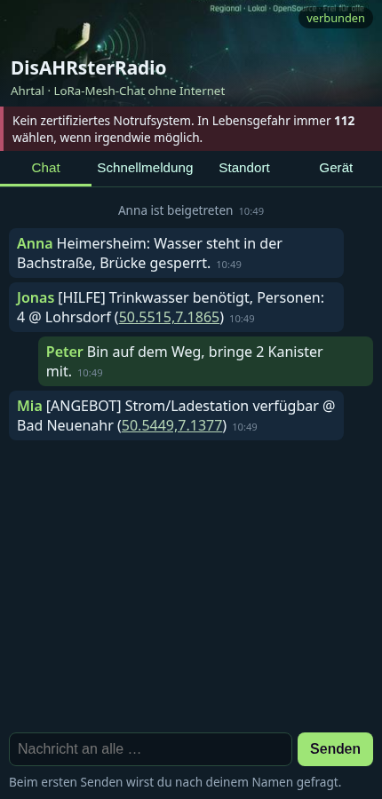

# DisAHRsterRadio


**Offline-Chat über LoRa-Mesh für das Ahrtal** – ein Gerät spannt ein eigenes WLAN auf, man verbindet sich mit dem Handy und schreibt im Browser. Die Nachrichten laufen per LoRa von Gerät zu Gerät weiter, ganz ohne Internet oder Mobilfunk.

Dieses Projekt ist ein modernisierter Fork von **[sudomesh/disaster-radio](https://github.com/sudomesh/disaster-radio)** mit der Ahrtal-Weboberfläche aus **[Pietwars/DisasterMesh](https://github.com/Pietwars/DisasterMesh)** – aber **ohne MeshCore**: Funk und Routing laufen über das ursprüngliche disaster-radio-Konzept (Layer1 + LoRaLayer2).

> ⚠️ **Wichtig:** DisAHRsterRadio ist **kein zertifiziertes Notrufsystem** und ersetzt keine Behörden-Kommunikation. In Lebensgefahr immer **112** wählen, wenn irgendwie möglich.

## Ehrlicher Stand (Oktober 2026)

| Punkt | Stand |
|---|---|
| Firmware baut für alle 3 Boards | ✅ (lokal und per GitHub Actions) |
| Auf echter Hardware getestet | ❌ **noch nicht** – weder Funk, WLAN noch Web-UI auf einem Gerät geprüft |
| Funkverbindung zwischen zwei Geräten | ❓ ungetestet |
| Kompatibel mit altem disaster-radio-Funk (915 MHz/US) | ❌ nein, EU868-Standard |
| Kompatibel mit MeshCore/DisasterMesh-Geräten | ❌ nein, anderes Funkprotokoll |

## Unterstützte Boards

| PlatformIO-Env | Board | Funkchip |
|---|---|---|
| `t3s3-sx1262` | LILYGO T3-S3 (Hauptziel) | SX1262 (TCXO 1,8 V) |
| `t3-v161-sx1276` | LILYGO T3 V1.6.1 | SX1276 |
| `heltec-v2-sx1276` | Heltec WiFi LoRa 32 V2 | SX1276 |

Heltec V2: WLAN-Sendeleistung auf 8,5 dBm reduziert und gestaffelter Start (600 ms zwischen WLAN und LoRa), weil an diesem Board Brownouts beobachtet wurden.

## Was gegenüber disaster-radio modernisiert wurde

- PlatformIO mit **pioarduino** (aktuelles Arduino-ESP32 3.3.x / ESP-IDF 5.5) statt altem Git-Stand der espressif32-Plattform
- **RadioLib 7.x** statt sandeepmistry/arduino-LoRa bzw. uraltem RadioLib-Commit; eine gemeinsame `Layer1_RadioLib` für SX1262 und SX1276 (SX1262 jetzt mit BUSY-Pin, TCXO, DIO2-HF-Schalter)
- **LoRaLayer2** (Routing von disaster-radio) liegt angepasst in `firmware/lib/LoRaLayer2` (Sende-/Empfangsleistung und SF zur Laufzeit, Konfigurationsausgabe auch für RadioLib)
- **ESP32Async/ESPAsyncWebServer + AsyncTCP** (gepflegte Forks), **LittleFS** statt SPIFFS, AsyncSDServer entfernt (SD über ESPAsyncWebServer)
- **EU868-Standard:** 869,525 MHz, 125 kHz, SF9, 14 dBm (Duty-Cycle-Begrenzung von LoRaLayer2 aktiv)
- WLAN-Zugangspunkt **`DisAHRsterRadio-XXXXXX`** mit **geräteindividuellem Zufallspasswort** (einmal erzeugt, im NVS gespeichert, beim Start seriell ausgegeben)
- BLE-UART von disaster-radio ist vorerst deaktiviert (Bluedroid-API passt nicht zu Arduino-ESP32 3.x auf dem S3; Build-Flag `HAS_BLE`)

## Weboberfläche (MeshAhrtal)



- Chat an alle (disaster-radio-WebSocket `/ws`, Format `<ID 2 Byte>c|<Name> Text`, Zustellbestätigung ✓ = vom Gerät angenommen, *nicht* beim Empfänger)
- Schnellmeldungen (Trinkwasser, Strom, Medikamente, Verletzt, Evakuierung, „Mir geht es gut“, Hilfe-Angebote)
- Standort: GPS des Telefons (funktioniert im Browser oft nur über HTTPS) oder Auswahl aus der Ortsliste Ahrtal (Ahrweiler … Sinzig)
- Geräteinfo über `GET /api/info` (JSON)
- Demo ohne Gerät: `web/static/index.html?demo=1` lokal öffnen

Die MeshCore-spezifischen Funktionen aus DisasterMesh (Kanäle, Direktnachrichten, Schwarzes Brett, Karten, POIs, Admin) sind **nicht** übernommen.

## Erste Schritte

```bash
pip install platformio
cd firmware
pio run -e t3s3-sx1262 -t upload      # Firmware
pio run -e t3s3-sx1262 -t uploadfs    # Weboberfläche (LittleFS)
pio device monitor                     # zeigt WLAN-Name und Passwort
```

Dann mit dem WLAN `DisAHRsterRadio-XXXXXX` verbinden und `http://192.168.4.1` öffnen (oder `http://disahrster.local`). Seriell/Telnet (Port 23) gibt es weiterhin die disaster-radio-Konsole.

## Bekannte Grenzen / offene Arbeit

- Hardwaretest auf allen drei Boards (Funk zwischen zwei Geräten, Reichweite, Stromaufnahme, Heltec-Brownout)
- Pinbelegung T3-S3 und T3 V1.6.1 nach Datenblatt/LILYGO-Beispielen gesetzt, nicht gemessen
- Keine Verschlüsselung/Signatur der Nachrichten (alle mit gleicher Frequenz können mitlesen und Namen fälschen)
- Nachrichtenlänge max. ca. 220 Byte; kein Direktchat, keine Kanäle
- Einstellung `loraFrq` ist ganzzahlig (869 = 869,525 MHz)
- OLED-, GPS-, SD- und History-Code von disaster-radio übernommen, ungetestet

## Lizenz und Danksagung

- Grundlage: [sudomesh/disaster-radio](https://github.com/sudomesh/disaster-radio) und [sudomesh/LoRaLayer2](https://github.com/sudomesh/LoRaLayer2) – vielen Dank an Sudo Mesh und alle Beteiligten. Git-Historie von disaster-radio ist erhalten, Original-README: [README.upstream.md](README.upstream.md).
- `firmware/`: GPLv3 und AGPLv3 (dual, wie upstream) – siehe `LICENSE-GPL-3.0.txt`, `LICENSE-AGPL-3.0.txt`
- `web/`: AGPLv3 (wie upstream). Die neue Ahrtal-Oberfläche stammt vom Autor aus DisasterMesh (dort MIT) und wird hier unter AGPLv3 veröffentlicht – MIT ist damit kompatibel.
- Kopfbild: aus [Pietwars/DisasterMesh](https://github.com/Pietwars/DisasterMesh).
