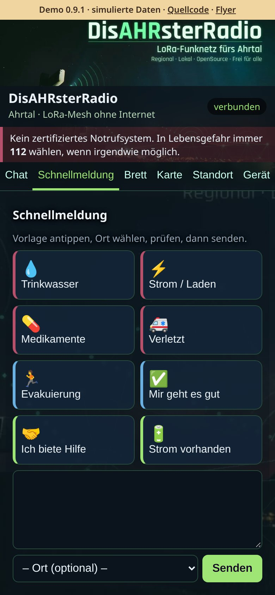
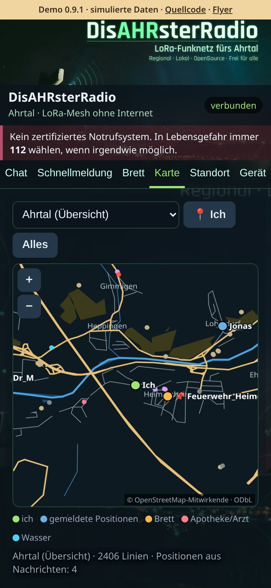

# DisAHRsterRadio

**Offline-Chat über LoRa-Funk fürs Ahrtal – modernisiertes disaster-radio ohne MeshCore, mit der Weboberfläche MeshAhrtal im Handy-Browser.**

Aufnahmen der [Live-Demo](https://pietwars.github.io/DisAHRsterRadio/) in Handygröße, Stand 0.9.4; alle Daten simuliert.

**Version 0.9.4** · disaster-radio/LoRaLayer2 + RadioLib 7 · Weboberfläche MeshAhrtal · 868 MHz

Flyer (A5): [Druck-PDF mit QR-Codes](https://github.com/Pietwars/DisAHRsterRadio/releases/tag/v0.9.4) · [Digital-PDF mit Links](https://github.com/Pietwars/DisAHRsterRadio/releases/tag/v0.9.4)

## Was kann es

- **T-Deck Plus Standalone:** lokale Oberfläche mit Bootlogo, Tastatur, ruhigem Trackball, Touch und gespeicherter Touch-Kalibrierung; WLAN bleibt zusätzlich verfügbar.
- **Chat an alle** im Browser – ohne App, ohne Internet (Chat reicht ein Funk-Sprung weit)
- **Schnellmeldungen:** Trinkwasser, Strom, Medikamente, Verletzt, Evakuierung, „Mir geht es gut“, Hilfe-Angebote
- **Schwarzes Brett:** Aushänge werden auf jedem Gerät gespeichert (bis 30) und über mehrere Geräte weitergereicht
- **Standort:** Handy-GPS oder Ortsliste Ahrtal (Ahrweiler … Sinzig)
- **Offlinekarten:** fünf OSM-Pakete (Ahrtal-Übersicht, Heimersheim mit Gebäuden, Dernau/Ahrweiler, Altenahr, Sinzig) direkt auf dem Gerät
- **Fünf Funkprofile** für 868 MHz mit Sendezeit-Buchführung (10 %)

## Unterstützte Geräte

| Board | Paket im [Release v0.9.4](https://github.com/Pietwars/DisAHRsterRadio/releases/tag/v0.9.4) | Stand |
|---|---|---|
| LILYGO T-Deck Plus **Standalone** | `DisAHRsterRadio-0.9.4-tdeck-standalone.zip` | Start, lokale Bedienung, Tastatur, Trackball, Touch und Hilfen vom Nutzer bestätigt; GPS/Karte draußen und umfassender Funk-/Dauertest noch offen |
| LILYGO T-Deck Plus (ESP32-S3, SX1262, 868 MHz) | `DisAHRsterRadio-0.9.4-tdeck.zip` | baut und ist automatisch geprüft (Flash-/Speicherprüfung im CI); auf Hardware noch nicht abgenommen |
| LILYGO T-Watch S3 (ESP32-S3, SX1262, 868 MHz) | `DisAHRsterRadio-0.9.4-twatch-s3.zip` | baut und ist automatisch geprüft (Flash-/Speicherprüfung im CI); auf Hardware noch nicht abgenommen |

**Standalone:** Das T-Deck-Plus-Paket `tdeck-standalone` wird direkt am Gerät bedient: Chat, Hilfe, Brett, schematische GPS-Ortsübersicht und SETUP. Beim ersten Start drei Zielkreuze und den Kontrollpunkt antippen; die Ausrichtung wird gespeichert. Wiederholen unter SETUP → Touch neu kalibrieren.

Die zusätzlichen Pakete `tdeck` und `twatch-s3` bleiben WLAN-Varianten mit dunklem Display. [Release v0.9.3](https://github.com/Pietwars/DisAHRsterRadio/releases/tag/v0.9.3) bleibt unverändert verfügbar. Andere Boards sind nicht mehr im Release; ältere Releases bleiben unverändert – siehe [Details](docs/DETAILS.md#unterstützte-boards).

## Schnellstart

1. **Flashen:** ZIP aus dem [Release](https://github.com/Pietwars/DisAHRsterRadio/releases/tag/v0.9.4) entpacken und für die lokale T-Deck-Bedienung `DisAHRsterRadio-0.9.4-tdeck-standalone-factory.bin` wählen; alternativ WLAN-Pakete `DisAHRsterRadio-0.9.4-tdeck-factory.bin` bzw. `DisAHRsterRadio-0.9.4-twatch-s3-factory.bin` an Adresse **0x0** schreiben (z. B. mit [esptool-js](https://espressif.github.io/esptool-js/)). Update ohne Datenverlust: nur `teile/firmware.bin` an 0x10000.
2. **Standalone:** T-Deck direkt mit Tastatur, Trackball und Touch bedienen. Die lokale Karte ist schematisch; die OSM-Webkarten bleiben im Browser.
3. **Zusätzlich verbinden:** Handy mit dem offenen WLAN `DisAHRsterRadio-XXXXXX` verbinden, **http://192.168.4.1** (oder http://disahrster.local) öffnen – kein Passwort, höchstens 4 Handys.

Keine MeshCore-App: Diese Firmware nutzt LoRaLayer2 (Bluetooth nur in separaten `*-ble`-Testprofilen). Mehr: [Offener Zugang](docs/OFFENER_ZUGANG.md)

## Funk

Standardprofil **EU Narrow: 869,618 MHz**, 62,5 kHz, SF8, CR 4/8, 14 dBm (SRD-Teilband 869,4–869,65 MHz, 10 % Sendezeit). Alle Geräte eines Netzes brauchen dasselbe Profil. Funkt mit HaldenFunk, **nicht** mit MeshCore- oder Meshtastic-Geräten. Alle Profile: [Details](docs/DETAILS.md#funkprofile-868-mhz-deutschland)

<!-- projektfamilie:start (in allen vier Repositorys identisch) -->
## Projektfamilie DisAHRsterRadio / HaldenFunk

| Repository | Inhalt | Funk | Version | Demo · Download · Flyer |
|---|---|---|---|---|
| [Pietwars/DisAHRsterRadio-MeshCore](https://github.com/Pietwars/DisAHRsterRadio-MeshCore) | MeshCore 1.18 mit kompakter MeshAhrtal-Oberfläche per WLAN plus Bluetooth für die MeshCore-App; Firmware für LILYGO T-Deck Plus und T-Watch S3 (Ahrtal) | MeshCore | 0.9.4 | [Live-Demo](https://pietwars.github.io/DisAHRsterRadio-MeshCore/) · [Release v0.9.4](https://github.com/Pietwars/DisAHRsterRadio-MeshCore/releases/tag/v0.9.4) · Flyer [Druck](https://pietwars.github.io/DisAHRsterRadio-MeshCore/flyer/DisAHRsterRadio-MeshCore-Flyer.pdf) / [digital](https://pietwars.github.io/DisAHRsterRadio-MeshCore/flyer/DisAHRsterRadio-MeshCore-Flyer-digital.pdf) |
| [Pietwars/DisAHRsterRadio](https://github.com/Pietwars/DisAHRsterRadio) | Ohne MeshCore: modernisiertes disaster-radio (LoRaLayer2, RadioLib) mit kompakter MeshAhrtal-Oberfläche; Firmware für LILYGO T-Deck Plus und T-Watch S3 (Ahrtal) | LoRaLayer2 | 0.9.4 | [Live-Demo](https://pietwars.github.io/DisAHRsterRadio/) · [Release v0.9.4](https://github.com/Pietwars/DisAHRsterRadio/releases/tag/v0.9.4) · Flyer [Druck](https://github.com/Pietwars/DisAHRsterRadio/releases/tag/v0.9.4) / [digital](https://github.com/Pietwars/DisAHRsterRadio/releases/tag/v0.9.4) |
| [Pietwars/HaldenFunk](https://github.com/Pietwars/HaldenFunk) | Regionalvariante von DisAHRsterRadio für Sangerhausen / Mansfelder Land, ohne MeshCore; Firmware für LILYGO T-Deck Plus und T-Watch S3 | LoRaLayer2 | 0.9.3 | [Live-Demo](https://pietwars.github.io/HaldenFunk/) · [Release v0.9.3](https://github.com/Pietwars/HaldenFunk/releases/tag/v0.9.3) · Flyer [Druck](https://github.com/Pietwars/HaldenFunk/releases/tag/v0.9.3) / [digital](https://github.com/Pietwars/HaldenFunk/releases/tag/v0.9.3) |
| [Pietwars/HaldenFunk-MeshCore](https://github.com/Pietwars/HaldenFunk-MeshCore) | Regionalvariante von DisAHRsterRadio-MeshCore für das Mansfelder Land: MeshCore 1.18, WLAN + Bluetooth; Firmware für LILYGO T-Deck Plus und T-Watch S3 | MeshCore | 0.9.2 | [Live-Demo](https://pietwars.github.io/HaldenFunk-MeshCore/) · [Release v0.9.2](https://github.com/Pietwars/HaldenFunk-MeshCore/releases/tag/v0.9.2) · Flyer [Druck](https://pietwars.github.io/HaldenFunk-MeshCore/flyer/HaldenFunk-MeshCore-Flyer.pdf) / [digital](https://pietwars.github.io/HaldenFunk-MeshCore/flyer/HaldenFunk-MeshCore-Flyer-digital.pdf) |

Diese vier Repositorys sind die aktive Projektfamilie. [Pietwars/DisasterMesh](https://github.com/Pietwars/DisasterMesh) ist **archiviert** und gehört nicht mehr dazu.

Gleiche Spalte **Funk** = Geräte können miteinander funken (gleiches Funkprofil vorausgesetzt). MeshCore- und LoRaLayer2-Varianten verstehen sich **nicht**.

**Namen:** **DisAHRsterRadio** = Projekt und Marke (WLAN `DisAHRsterRadio-XXXXXX`) · **MeshAhrtal** = die Weboberfläche im Handy-Browser · **HaldenFunk – Glück Auf** = Regionalvariante fürs Mansfelder Land (WLAN `HaldenFunk-XXXXXX`).

Alle Demos sind simuliert.
<!-- projektfamilie:end -->

## Sicherheit

> ⚠️ Prototyp, **kein zertifiziertes Notrufsystem**. Im Notfall immer **112** wählen. Offenes, unverschlüsseltes WLAN und Funk: Jede Person in Reichweite kann mitlesen und senden.

## Mehr Doku

[Details (ausführlich, inkl. In Arbeit und Grenzen)](docs/DETAILS.md) · [Offener Zugang](docs/OFFENER_ZUGANG.md) · [Solarbox](hardware/solarbox/) · [Änderungen](CHANGELOG.md) · [Original-README disaster-radio](README.upstream.md)

## Lizenz

Grundlage: [sudomesh/disaster-radio](https://github.com/sudomesh/disaster-radio) und [LoRaLayer2](https://github.com/sudomesh/LoRaLayer2) – danke an Sudo Mesh. `firmware/`: GPLv3 und AGPLv3 (dual, wie upstream); `web/`: AGPLv3. Kartendaten © OpenStreetMap-Mitwirkende, ODbL 1.0.
